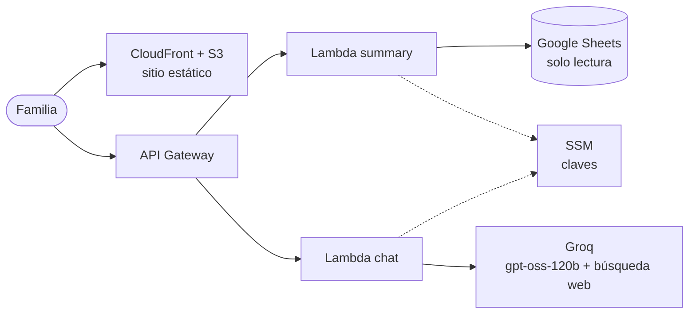

# Coveñas 2026–27

Sitio del viaje familiar a Coveñas (Sucre, Colombia): **cuentas claras por persona**, un
**planeador de ruta en Tesla** con simulador y asistente de IA, y todo con datos en vivo.


**🌊 Sitio en vivo:** https://covenas.taxopsapp.com/
**API (JSON):** https://4ykqwctvr7.execute-api.us-east-1.amazonaws.com/api/summary

| Dónde | Qué hay |
|---|---|
| [`/`](https://covenas.taxopsapp.com/) | Inicio: cuenta regresiva, estado del recaudo y accesos |
| [`/cuentas.html`](https://covenas.taxopsapp.com/cuentas.html) | Balance por grupo y persona, gastos, abonos y cuánto falta de la cabaña |
| [`/tesla.html`](https://covenas.taxopsapp.com/tesla.html) | Simulador de ruta, plan B si falla un cargador, asistente con IA |

---

## Qué hace

**Cuentas**
- La cabaña ($6.860.000 COP, 6 noches) se reparte **por noche y por persona**, no parejo: quien
  llega o se va distinto paga proporcional, sin casos especiales.
- Cada grupo familiar ve lo que le corresponde, lo abonado, lo que falta y si está al día.
- Los gastos variables se registran en la hoja y se reparten entre quienes participan.

**Ruta Tesla (Medellín ⇄ Coveñas, Model Y RWD)**
- Simula dónde cargar, cuánto tardas y con cuánta batería llegas, ida y regreso.
- Compara escenarios y muestra qué pasa **si falla cada cargador** (Fátima es el punto crítico).
- Un asistente con IA, con búsqueda web, responde dudas y propone planes que el simulador corre.
- Se apoya en reportes reales de otros conductores, no solo en estimaciones de ficha técnica.

## Arquitectura



El detalle (flujos, simulador, asistente, modelo de datos, seguridad, CI/CD, costos y la propuesta
de mover los datos fuera de Sheets) está en [`docs/ARQUITECTURA.md`](docs/ARQUITECTURA.md).

## Stack

| Capa | Tecnología |
|---|---|
| Frontend | HTML, CSS y JS planos, sin build; multipágina |
| Entrega | S3 privado + CloudFront (dominio propio en Cloudflare) |
| API | API Gateway HTTP API + Lambda Python 3.12 |
| Datos de cuentas | Google Sheets leído con una Service Account de solo lectura |
| IA | Groq (`openai/gpt-oss-120b` con `browser_search`) |
| Secretos | SSM Parameter Store (`SecureString`), fuera de Terraform |
| IaC | Terraform, state remoto en S3 |
| CI/CD | GitHub Actions con OIDC (sin llaves de AWS en GitHub) |

## Estructura

```
.
├── frontend/
│   ├── index.html          # inicio
│   ├── cuentas.html        # dashboard de cuentas
│   ├── tesla.html          # ruta Tesla
│   ├── site.css            # estilos compartidos (claro/oscuro)
│   ├── tesla.css           # estilos de la página Tesla
│   ├── tesla.js            # motor del simulador, UI y chat
│   ├── tesla-data.js       # datos y supuestos de la ruta
│   └── config.js           # URL del API
├── lambda/
│   ├── handler.py          # GET /api/summary: lee la hoja y calcula balances
│   └── chat.py             # POST /api/chat: asistente con Groq
├── infra/                  # Terraform (S3, CloudFront, Lambdas, API, IAM, OIDC)
├── docs/
│   ├── ARQUITECTURA.md     # diagramas y decisiones
│   └── google-service-account-setup.md
├── .github/workflows/      # terraform-plan (PR) y terraform-apply (main)
└── Gastos_Covenas.xlsx     # instantánea histórica; la fuente real es la hoja en vivo
```

## Puesta en marcha

Requisitos: AWS CLI con SSO, Terraform, `direnv` (el `.envrc` carga el perfil de AWS y la cuenta de
GitHub correctos) y Python 3 con `pip`.

1. **Clave de la Service Account de Google** → SSM. Ver
   [`docs/google-service-account-setup.md`](docs/google-service-account-setup.md).
2. **Clave de Groq** (gratis en console.groq.com) → SSM, sin pegarla en chats ni en código:

   ```bash
   read -rs "GROQ_KEY?Token de Groq: "
   aws ssm put-parameter --region us-east-1 --name "/covenas-dashboard/groq-api-key" \
     --type SecureString --value "$GROQ_KEY" --overwrite; unset GROQ_KEY
   ```

   Sin esta clave el chat responde 503 y el resto del sitio funciona normal.
3. **Desplegar.** Abre un PR: el plan corre solo. Al mergear a `main`, `terraform apply` espera la
   aprobación en el entorno `production`. A mano: [`infra/README.md`](infra/README.md).
4. **Invalidar la caché** de CloudFront si cambiaste una página que ya existía.

## Datos y privacidad

- **Las cuentas se editan en Google Sheets**, no en este repo. `Gastos_Covenas.xlsx` es solo una
  copia histórica y está desactualizada.
- Los chats de WhatsApp usados para calibrar el simulador **no se versionan** (ver `.gitignore`):
  contienen datos de terceros. El simulador solo guarda los reportes ya anonimizados en
  `frontend/tesla-data.js`.
- Hay una propuesta para sacar los datos de Sheets y Drive hacia DynamoDB:
  [`docs/ARQUITECTURA.md` §9](docs/ARQUITECTURA.md#9-decisión-pendiente-dónde-viven-los-datos).

## Costo

Pensado para quedar en la capa gratuita de AWS y de Groq con el tráfico de una familia. Hay un
presupuesto de 1 USD/mes con alerta por correo como red de seguridad. Detalle por servicio en
[`docs/ARQUITECTURA.md` §8](docs/ARQUITECTURA.md#8-costos-y-límites).

## Apagado

El sitio es temporal: después del viaje (~enero 2027) se destruye con `terraform destroy` y se
limpian a mano las claves de SSM y los registros DNS. Pasos completos en
[`docs/ARQUITECTURA.md` §11](docs/ARQUITECTURA.md#11-apagado-después-del-viaje). La hoja de cálculo
no se borra: son los datos reales de la familia.

## Convenciones

- Cada recurso de AWS lleva etiquetas vía `default_tags` (`Project`, `ManagedBy=terraform`, ...).
- Los commits van firmados con `Signed-off-by` y sin atribución a herramientas.
- Cambios por PR; el apply a producción siempre pasa por aprobación manual.
