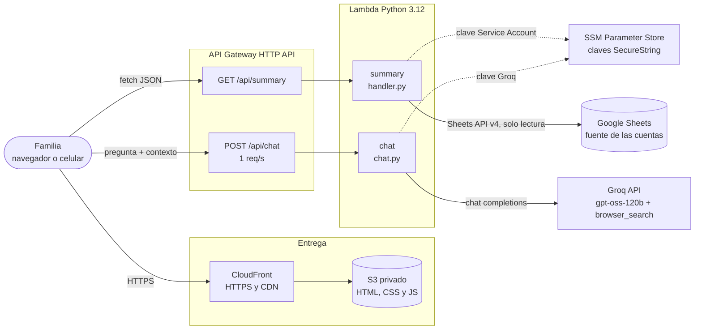
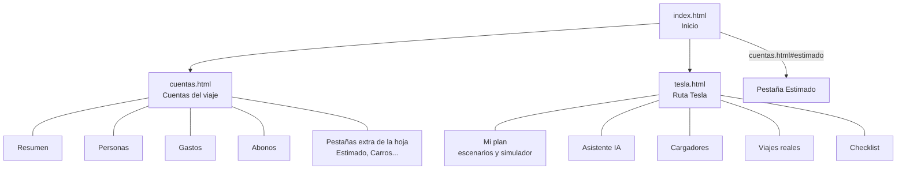
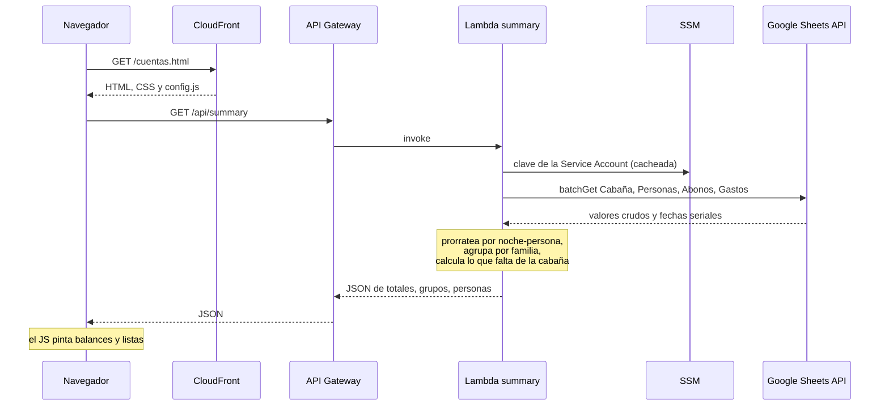
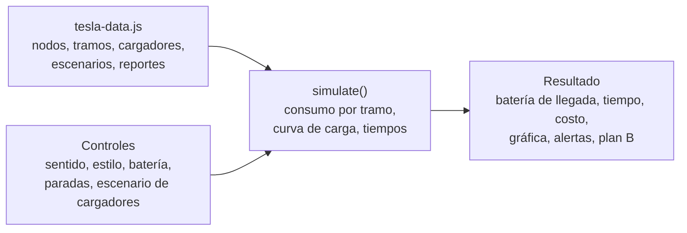
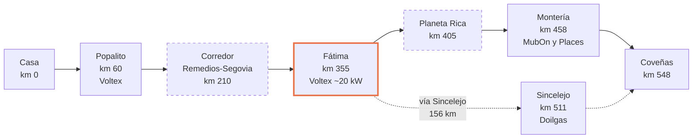
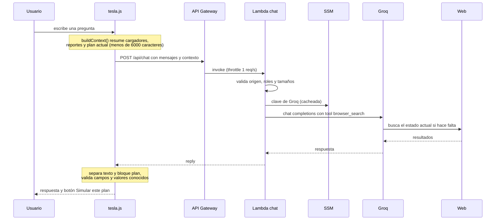
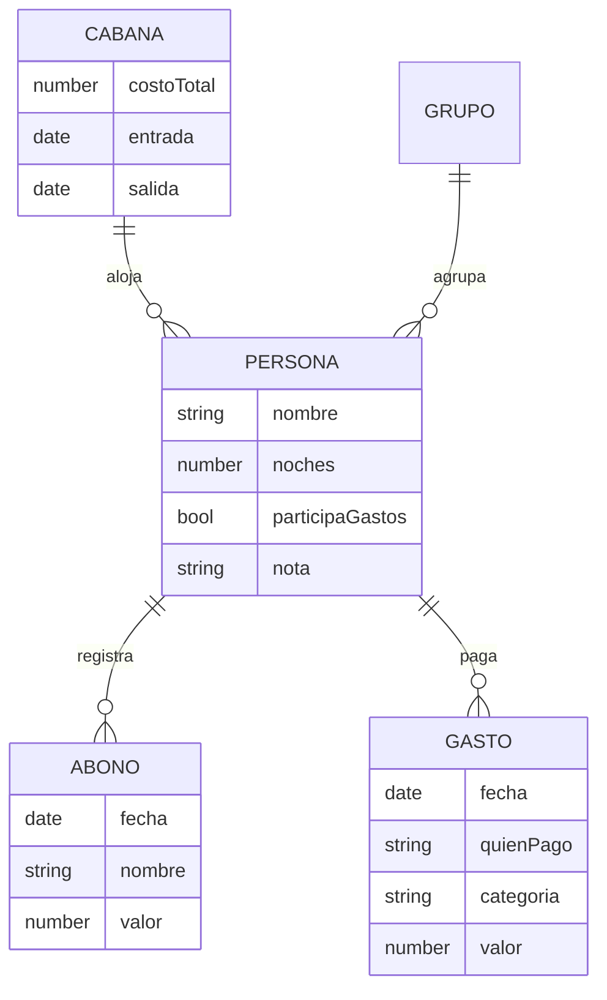
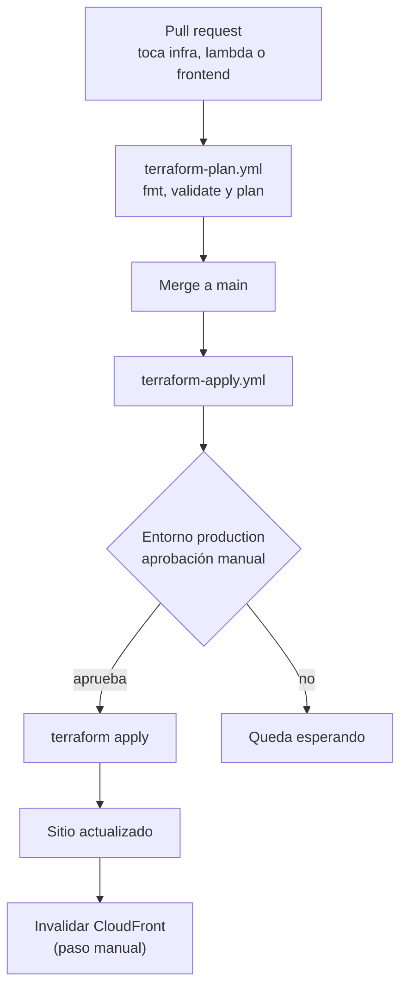
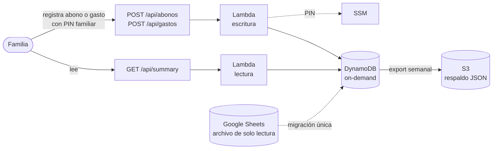

# Arquitectura — Coveñas 2026–27

Documento de referencia de cómo está armado el sitio, por qué, y qué sigue. Los diagramas usan
[Mermaid](https://mermaid.js.org/) y se ven directo en GitHub.

**Contenido**

1. [Visión general](#1-visión-general)
2. [Mapa del sitio](#2-mapa-del-sitio)
3. [Flujo de las cuentas](#3-flujo-de-las-cuentas)
4. [Ruta Tesla: simulador y asistente](#4-ruta-tesla-simulador-y-asistente)
5. [Modelo de datos y lógica de negocio](#5-modelo-de-datos-y-lógica-de-negocio)
6. [Seguridad y privacidad](#6-seguridad-y-privacidad)
7. [Infraestructura, estado y CI/CD](#7-infraestructura-estado-y-cicd)
8. [Costos y límites](#8-costos-y-límites)
9. [Decisión pendiente: dónde viven los datos](#9-decisión-pendiente-dónde-viven-los-datos)
10. [Gotchas ya resueltos](#10-gotchas-ya-resueltos)
11. [Apagado después del viaje](#11-apagado-después-del-viaje)

---

## 1. Visión general

Un sitio estático multipágina (landing, cuentas y ruta Tesla) servido desde CloudFront, con dos
funciones Lambda detrás de un API Gateway: una lee las cuentas de Google Sheets y otra conecta el
asistente de la ruta con Groq. Todo se despliega con Terraform en la cuenta AWS `ai-platform`.



**Principios de diseño**

- **El frontend es una vista.** Las reglas de negocio de las cuentas viven en `lambda/handler.py`;
  el frontend solo pinta JSON.
- **Todo gratis y desechable.** Capa gratuita de AWS y de Groq, y un `terraform destroy` borra casi
  todo (ver [apagado](#11-apagado-después-del-viaje)).
- **Secretos fuera del código y de Terraform.** Las claves se suben a SSM a mano; Terraform solo
  conoce sus nombres.
- **Cero dependencias en el navegador.** HTML, CSS y JS planos, sin build ni frameworks.

---

## 2. Mapa del sitio



| Archivo | Rol | Datos |
|---|---|---|
| `index.html` | Landing: cuenta regresiva, estado del recaudo, accesos | `GET /api/summary` (con respaldo si falla) |
| `cuentas.html` | Dashboard de cuentas con pestañas enlazables | `GET /api/summary` |
| `tesla.html` | Simulador y asistente | `tesla-data.js` local + `POST /api/chat` |
| `site.css` | Estilos y tokens compartidos (claro/oscuro) | n/a |
| `config.js` | URL del API (se deriva la del chat) | n/a |

Las pestañas extra de `cuentas.html` se descubren dinámicamente: si la familia agrega una pestaña
a la hoja, aparece sola. La pestaña `Tesla` de la hoja se oculta a propósito porque la ruta Tesla
tiene su propia página.

---

## 3. Flujo de las cuentas



---

## 4. Ruta Tesla: simulador y asistente

### 4.1 Simulador (100% en el navegador)

`tesla-data.js` guarda datos y supuestos; `tesla.js` contiene un motor puro (`simulate`) y la UI.
No hay backend para simular: cada cambio de un control recalcula al instante.



Ruta modelada (km desde la casa; los puntos con borde punteado son **hipótesis**, no cargadores
confirmados):



El motor se calibra contra reportes reales de conductores (por ejemplo, Popalito 100% llega a
Fátima con 22–35%). Para cada plan calcula también el **mínimo con el que hay que salir de cada
parada** y repite la simulación sin cada cargador para mostrar qué pasa si falla.

### 4.2 Asistente con IA



Decisiones clave del asistente:

- **La IA no calcula la batería.** Propone un plan en JSON (`dir`, `route`, `startSoc`, `style`,
  `stops`) y el navegador lo valida y lo corre en el simulador. Así los números son verificables y
  no hay que duplicar el motor en Python.
- **Contexto como mensaje de usuario, no de sistema.** El contexto lo arma el cliente, así que
  nunca tiene autoridad de instrucción; además se limita su tamaño.
- **Cero invención.** El prompt exige marcar como "sin verificar" lo que no esté en el contexto ni
  en una fuente web citada.
- **Errores legibles.** 429 (límite de Groq), 503 (clave sin configurar), 504 (búsqueda lenta) y 403
  (origen no permitido) se traducen a mensajes claros.
- **Modelo.** `openai/gpt-oss-120b`: es de los que soportan `browser_search` en Groq (Compound se
  retiró el 21 de septiembre de 2026).

---

## 5. Modelo de datos y lógica de negocio

Modelo lógico actual (las pestañas de la hoja):



Reglas (viven en `lambda/handler.py`):

1. **Tarifa por persona-noche** = `costo de la cabaña / Σ noches de todas las personas`. Quien llega
   tarde paga menos sin ningún caso especial.
2. **Costo de cabaña de cada persona** = sus noches × esa tarifa.
3. **Gastos variables** se reparten en partes iguales entre quienes participan.
4. **Lo que falta de la cabaña** se calcula por grupo (`cabaña del grupo − abonos del grupo`) y se
   reparte entre sus miembros según sus noches, porque normalmente abona una sola persona por todos.
5. Un grupo se marca `pending` si su etiqueta o nota indica que no está confirmado (heurística
   genérica, sin nombres escritos en el código).

---

## 6. Seguridad y privacidad

| Tema | Medida |
|---|---|
| Cuentas | La Service Account tiene acceso **Viewer** a la hoja: la Lambda no puede escribir. |
| Claves | Google y Groq viven en SSM `SecureString`, creadas a mano; no pasan por Terraform ni por el state. |
| Permisos | Cada Lambda tiene su propio rol y solo lee su propia clave (`ssm:GetParameter` sobre un ARN). |
| Chat | Filtro por `Origin`, límites de tamaño, throttle por ruta (1 req/s) y tope de tokens de salida. |
| Contenido de chats | No se registran los mensajes; solo códigos de estado y tamaños. |
| Frontend | Bucket S3 privado, acceso solo vía CloudFront con OAC. |
| API de cuentas | Sin autenticación (solo lectura, datos de bajo riesgo, URL no adivinable). |
| Datos de terceros | Las exportaciones de WhatsApp y contactos **no deben estar en el repo**; ver `.gitignore`. |

Riesgos abiertos, en orden:

1. **Historial público del repo.** Los chats de WhatsApp (con números de teléfono) y las fotos
   estuvieron versionados. Quitarlos del árbol no los borra del historial: la solución es hacer el
   repo privado y, si se quiere, reescribir la historia.
2. **Enlace de la hoja.** El ID de la hoja está en el repo; si el enlace permite "cualquiera con el
   enlace puede editar", cualquiera podría editarla. Revisar el permiso compartido.
3. **Uso del chat por terceros.** Quien conozca la URL puede gastar la cuota gratuita de Groq (el
   costo en dinero es cero). Mitigado con el filtro de origen y el throttle.

---

## 7. Infraestructura, estado y CI/CD

Todo está en `infra/` (Terraform). Cada recurso lleva etiquetas vía `default_tags`.



- **Autenticación en CI:** OIDC de GitHub hacia un rol de IAM acotado a este repo. No hay llaves de
  AWS guardadas en GitHub.
- **State remoto:** bucket S3 de la cuenta `ai-platform` con locking nativo y una `key` propia
  (`trip-covenas/terraform.tfstate`).
- **Empaquetado de Lambda:** un `null_resource` instala dependencias para Linux x86_64 y copia
  `handler.py` y `chat.py` en un solo zip compartido por ambas funciones.
- **Caché:** CloudFront cachea ~24 h. Tras cambiar una página existente, invalida:

  ```bash
  aws cloudfront create-invalidation --distribution-id <id> --paths "/*"
  ```

---

## 8. Costos y límites

| Servicio | Capa gratuita | Uso esperado |
|---|---|---|
| Lambda | 1 M invocaciones/mes | Cientos |
| API Gateway (HTTP API) | 1 M llamadas/mes durante 12 meses | Cientos |
| CloudFront | 1 TB de salida/mes | Kilobytes |
| S3 | 5 GB durante 12 meses | Unos pocos archivos |
| SSM (Standard) | Gratis | 2 parámetros |
| Groq (plan gratuito) | ~30 req/min y ~8 000 tokens/min en gpt-oss | Pocas preguntas al día |

Hay un presupuesto de AWS de 1 USD/mes con alerta por correo como red de seguridad. El límite que
sí se nota es el de Groq: el chat avisa "espera un minuto" cuando se agota.

---

## 9. Decisión pendiente: dónde viven los datos

Hoy las cuentas se editan en **Google Sheets** (la familia lo usa desde el celular) y esa hoja vive
en Google Drive. Esa dependencia se puede cambiar. Estas son las opciones evaluadas:

| Opción | A favor | En contra |
|---|---|---|
| **A. Seguir con Sheets** | Cero trabajo, la familia ya lo usa | Datos en Drive, permisos de enlace, sin historial ni validación |
| **B. DynamoDB en la misma cuenta AWS** | Gratis (on-demand), IaC, se borra con el destroy, sin otra cuenta | Hay que construir la pantalla de captura y el acceso de escritura |
| **C. Supabase o Neon (Postgres)** | Editor de tablas y autenticación ya hechos | Otro proveedor; el plan gratuito pausa proyectos inactivos |
| **D. Notion o Airtable** | Fácil de editar | Sigue siendo un tercero con cuentas de usuario; límites del plan gratuito |
| **E. JSON en el repo** | Auditable y versionado | No se edita desde el celular sin tocar Git |

**Recomendación: opción B (DynamoDB) con formularios en el propio sitio**, y dejar la hoja como
archivo de solo lectura. Arquitectura propuesta:



Por qué B: ya estamos en AWS, es gratis a este volumen, se versiona y se destruye con el resto, y
la lógica de prorrateo no cambia (solo cambia de dónde lee la Lambda). Lo que cuesta: un
formulario de captura (abono, gasto, persona) en el frontend, un PIN familiar para escribir y un
script de migración de la hoja actual. Las lecturas siguen siendo públicas.

Plan en pasos pequeños (cada uno desplegable por separado): tabla DynamoDB y migración, lectura
desde DynamoDB detrás de una bandera, formularios con PIN, congelar la hoja.

---

## 10. Gotchas ya resueltos

- **Filas "Total X:" fantasma.** Cada hoja termina con una fila de resumen en la misma columna que
  se usa para detectar datos; sin filtrarla se contaba doble. `_parse_rows` descarta cualquier fila
  cuyo valor empiece con "total".
- **`cryptography` es un binario.** Un `pip install` en macOS empaqueta el binario equivocado y
  Lambda falla con `invalid ELF header`. El build fuerza
  `--platform manylinux2014_x86_64 --only-binary=:all:`.
- **Trust del OIDC de GitHub.** El claim `sub` incluye IDs numéricos, así que la política de
  confianza usa comodines (`repo:owner*/repo*:*`).
- **Compound de Groq retirado.** Se usa `gpt-oss-120b` con `browser_search`, que no es compatible
  con salidas estructuradas; por eso el plan viaja en un bloque de texto que el navegador valida.

---

## 11. Apagado después del viaje

```bash
cd infra && terraform destroy
```

Borra S3, CloudFront, las dos Lambdas, API Gateway, roles de IAM, el certificado y el presupuesto.
Aparte, a mano:

1. `aws ssm delete-parameter` para `/covenas-dashboard/google-service-account` y
   `/covenas-dashboard/groq-api-key`.
2. Los dos registros DNS de `covenas.taxopsapp.com` en Cloudflare.
3. Revocar la Service Account en GCP y la clave de Groq.

**Nunca borrar la hoja de cálculo** como parte de la limpieza: son los datos reales de la familia.
